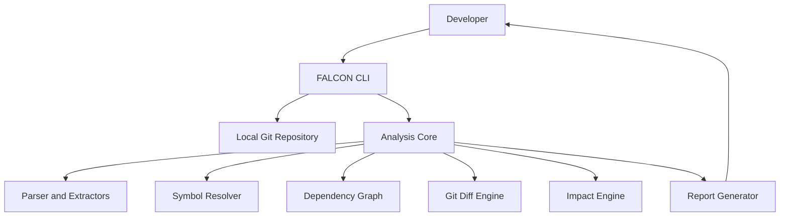
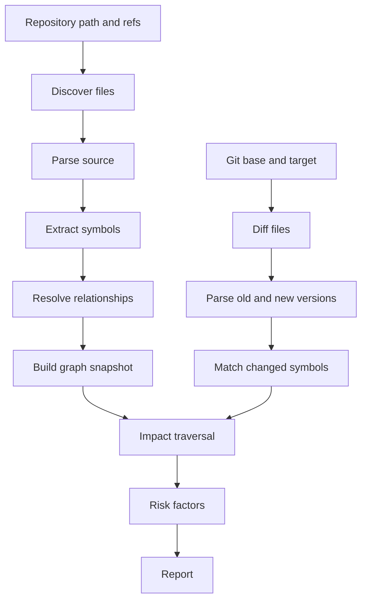
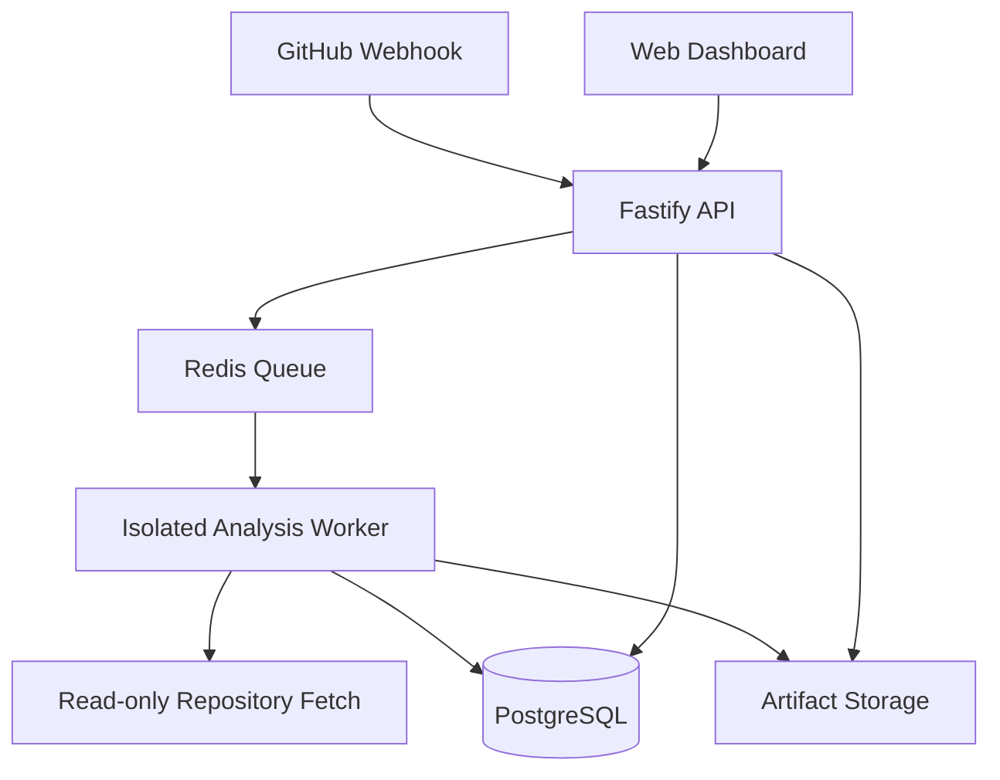

# FALCON Architecture

## 1. Architecture style

CLI-first modular monolith with clean package boundaries. A separate worker and API may be introduced after the core engine proves useful.

## 2. Context diagram

## 3. Core component responsibilities

| Component | Owns | Must not own |
|---|---|---|
| Repository scanner | File enumeration, ignore rules | Parsing semantics |
| Parser | AST creation and syntax diagnostics | Git operations |
| Extractor | Symbol and relationship candidates | UI/report formatting |
| Resolver | Module and symbol binding | Risk scoring |
| Graph engine | Nodes, edges, traversal | Filesystem access |
| Diff engine | Revision comparison and symbol matching | Graph visualization |
| Impact engine | Reachability and impact paths | HTTP or database |
| Risk engine | Heuristic factors and rationale | Claiming failure probability |
| Reporter | JSON/text serialization | Analysis decisions |
| CLI | Input validation and orchestration | Reimplementing domain logic |

## 4. Domain flow

## 5. Package dependency rules

- `domain` types are lowest-level and have no infrastructure dependency.
- `parser` may depend on TypeScript compiler packages.
- `graph` depends only on domain types.
- `impact` depends on graph interfaces and domain types.
- `diff` depends on Git adapter interfaces and parser/domain interfaces.
- `cli` composes adapters and use cases.
- Future `api` and `worker` compose the same use cases; they do not fork analysis logic.

## 6. Execution model

MVP is synchronous from the CLI user's perspective. Internally, operations may use bounded concurrency for parsing. Every analysis run has:
- Run ID.
- Repository root.
- Base and target refs (for impact runs).
- Analyzer version.
- Configuration hash.
- Start/end time.
- Diagnostics.
- Output artifact.

## 7. Future service topology

Future hosted execution requires explicit tenant isolation, secret handling, quotas, source retention controls and sandboxing.
